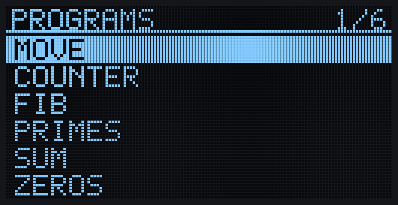

# Firmware

The emulator core running on a Raspberry Pi Pico with a 128x64 OLED and a 4x4 button keypad. Programs from `../compiler` are built into the firmware, and a menu on the screen picks which one to run.



*The menu, drawn by the firmware's own code (this picture comes from the desktop build, not from a photo).*

**Status:** The Pico firmware builds (CI builds it), and everything in it that doesn't touch a pin is tested on the desktop. It has not yet run on a physical board: I wrote it against the datasheets and SDK without hardware in hand, so the first power-up is the real test. See "First power-up" below.

## Layout

```
firmware/
├── src/
│   ├── main.cpp              the run loop: menu, running a program, 60 Hz timing
│   ├── platform.h            the interface to the hardware: 9 functions
│   ├── menu.*  text.*        the program menu and the 5x7 font it uses
│   ├── frame_clock.h         exact 60 Hz pacing
│   ├── key_gate.h            hides the key that started a program from it
│   └── rom_entry.h           one built-in program (name, bytes, size)
├── host/
│   └── host_platform.cpp     desktop implementation (terminal)
├── pico/
│   ├── pico_platform.cpp     Pico implementation: I2C OLED, GPIO keypad, MENU button, buzzer
│   ├── oled_frame.*          pixels -> SSD1306 memory (no SDK)
│   ├── keypad_matrix.*       key matrix decode + debounce (no SDK)
│   ├── pins.h                pin assignments
│   └── CMakeLists.txt        Pico SDK build
├── tools/make_roms.py        programs (.asm, .nib, .ch8) -> the table the menu shows
├── tests/                    unit tests for everything marked "no SDK" or portable
├── docs/                     parts list, wiring
└── Makefile                  desktop demo and tests
```

The run loop only talks to hardware through `platform.h`: set up, read the clock, sleep, show a frame, read the keys, read the MENU button, set the buzzer, get a random seed, and say whether to keep running. Each target implements those once. The emulator core underneath has no OS or I/O dependencies (`make check-core` in `../cpu-emulator` enforces it), which is what makes the port this small.

## On the desktop

```
make run      # build the run loop with one program and run it for about two seconds
make menu     # same, with six programs, so it draws the menu instead
make test     # unit tests (menu, font, timing, OLED packing, keypad, ROM table tool)
```

`make run ROMS="a.asm b.nib"` builds in programs of your choice. The desktop has no keys, so the menu just draws itself.

## On a Pico

Parts and wiring: `docs/parts-list.md` and `docs/wiring.md`. Then:

```
git clone --branch 2.1.1 https://github.com/raspberrypi/pico-sdk
export PICO_SDK_PATH=$PWD/pico-sdk
# also needs: cmake, gcc-arm-none-eabi (and its newlib), Python 3

cd firmware/pico
mkdir build && cd build
cmake ..        # builds in the example programs, with a menu to choose
make
```

That produces `chip8_pico.uf2`. Hold the BOOTSEL button while plugging the Pico in over USB, and copy the file onto the drive that appears. It restarts and shows the menu.

Choosing what gets built in:

```
cmake -DROMS="/path/a.asm;/path/b.nib;/path/c.ch8" ..   # your own list, in menu order
cmake -DROMS=/path/fib.nib ..                           # one program: no menu, runs at once
cmake -DCYCLES_PER_FRAME=20 ..                          # faster (12 = about 720 instructions/s)
cmake -DPICO_BOARD=pico2 ..                             # Pico 2 (it compiles; untested like the rest)
```

The default build is about 20 KB of flash and 18 KB of RAM (the Pico has 2 MB and 264 KB).

## Using it

- **Menu:** keypad `2` moves up, `8` moves down, `5` runs the highlighted program. The title shows your position (`3/6`) and the list scrolls.
- **Leaving a program:** hold the MENU button for about 0.2 s. With only one program built in, that restarts it.
- **In a program:** the 16 keys are the CHIP-8 pad (`1 2 3 C / 4 5 6 D / 7 8 9 E / A 0 B F`). The key you pressed to start a program is hidden from it until you let go.
- **Sound:** the buzzer sounds while the CHIP-8 sound timer is running.

## How it works

- **Display.** Each CHIP-8 pixel is drawn as a 2x2 block on the 128x64 screen. The frame is packed into the OLED's memory layout (8 rows per "page") and only the pages that changed are sent, over I2C at 1 MHz, so a full redraw takes under 10 ms and a static screen costs nothing. The menu is drawn at the display's full 128x64 with a 5x7 font.
- **Keys.** The Pico drives each keypad row in turn and reads the columns. A key counts once two scans in a row agree (about 17 ms), which filters contact bounce. Unlike the terminal front end, real buttons report release, so no timeout is needed.
- **Timing.** A frame is 16.67 ms, which a millisecond clock can't count, so the loop alternates 16, 17 and 17 ms waits: exactly 60 Hz, where a flat 16 ms would make the timers run 4% fast. If a frame ever runs more than 100 ms late it starts over instead of rushing to catch up.
- **Programs.** `tools/make_roms.py` builds each program with the same assembler and compiler as the desktop and writes them into a C table, so one tool serves the desktop demo and the Pico build.
- **Memory.** The emulator's 6 KB of state is static, not on the stack (the Pico's default stack is 2 KB), and `Chip8::reset()` clears it in place when you switch programs.
- **Random numbers.** Each program start seeds `CXNN` from the chip's hardware noise source, so it doesn't repeat the same sequence every time.

## First power-up

Things to check, in order, if something looks wrong:

1. **Blank screen.** Check VCC on 3V3, SDA/SCL not swapped, and the I2C address: most modules are `0x3C`, some `0x3D` (`OLED_I2C_ADDRESS` in `pico/pins.h`).
2. **Garbled or shifted picture.** A 1.3" display is often an SH1106 rather than an SSD1306; it needs a 2-column offset.
3. **Keys wrong.** Swap row/column wires as described in `docs/wiring.md`.
4. **MENU button does nothing.** It should join GP19 to GND; the pin is pulled up inside the Pico.
5. **Display glitches at 1 MHz.** Some modules only like 400 kHz; change `OLED_I2C_HZ`. Timers then run slightly slow on animated screens.

## Next up

- Run it on a real board and add a photo or video
- Load programs over USB instead of building them in
- ESP32 port (one more `platform.h` implementation)
